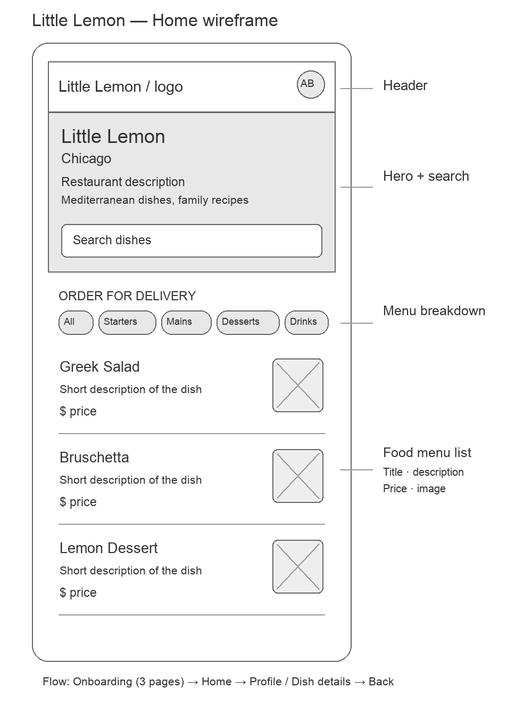

# Little Lemon — iOS App Capstone

SwiftUI food menu app with three-page onboarding, a persistent local profile,
asynchronous course-menu loading, Core Data cache, search, category filters and
native stack navigation. Prepared with AI assistance: review before making any
personal authorship declaration on Coursera.

## Download the Xcode project

Download [LittleLemonCapstone.zip](LittleLemonCapstone.zip), unzip it, and open
`LittleLemonCapstone/LittleLemonDinnerMenu.xcodeproj`. The archive contains all
Swift source, the Xcode project and scheme, tests, wireframe and verification notes.

## Run and review

Open `LittleLemonDinnerMenu.xcodeproj`, select the `LittleLemonDinnerMenu` scheme
and an iPhone simulator, then Run. No packages or API keys are required. The
practice scheme name is retained; bundle ID is `org.learning.LittleLemonCapstone`.

1. First launch: enter names, Next, email/optional phone, Next, Register on page 3.
2. Home has a header, hero with search, category bar and summarized dish rows.
3. Search GREEK, clear search, select Starters/Mains/Desserts/All.
4. Open a dish and go Back; open Profile from the header avatar.
5. Edit and Save changes. Terminate/reopen: the saved details persist.
6. Log out and confirm: profile data clears and onboarding starts empty.

This is a learning app: no remote account or real order/payment is created.
Profile details stay on device and are never sent to the food API.

## Design and data

- `wireframe-home.jpg` and editable `wireframe-home.svg` show the Home layout.
  They are locally authored wireframes; no Figma export is claimed.
- Menu and photos: https://github.com/Meta-Mobile-Developer-PC/Working-With-Data-API
- `LittleLemon/menu.json` is a saved course-menu copy for an explicitly labeled
  offline fallback. Online refresh uses the current HTTPS response.
- Core Data caches unique IDs transactionally; repeated refreshes do not duplicate.
- `DESIGN.md` and `UX-CONTRACT.md` document shared visual and interaction choices.

## Validation

On November 8, 2026, Xcode 27.2 built the simulator app successfully. Three XCTest
tests passed on iPhone 18 Pro/iOS 27.2: profile edits survive restart and logout
clears data; invalid registration is rejected; Core Data deduplicates menu items
and local category/search filtering works. Manual simulator observations are
recorded in `VERIFICATION.md` after they are actually performed.

No project submission, GitHub push or peer-review completion is implied here.
